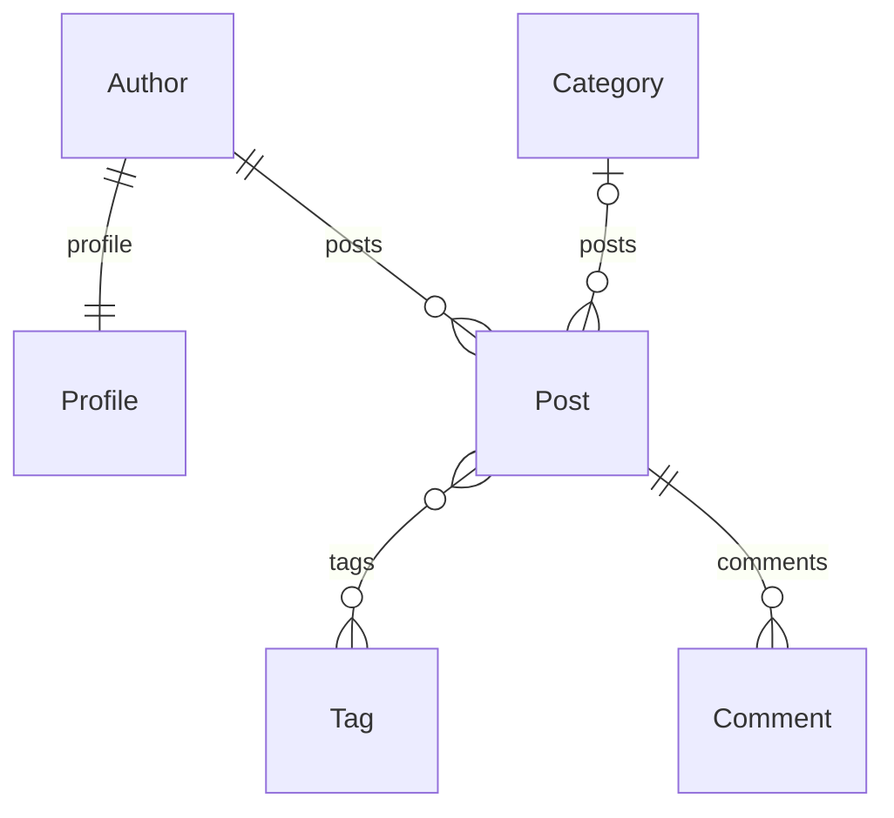

# Lab 07 ORM con IA

Alumna: Grecia Huanco Ticona.

Esta práctica continúa el repositorio de Lab 06. Se incorpora `src/blog` del
docente y su portada en `/lab07/`. La aplicación `news` mantiene sus modelos y
sus noticias: no se adapta el verificador cambiando las respuestas esperadas.

## Procedencia

Repositorio: https://github.com/Hellscythe25/dae-s07-orm-con-ia
Commit de origen: 8e7b74486fbd924dd0274c30d62914adc5a27419.
Los archivos iniciales de blog se conservan como material del docente.

## Puntos 1 a 3 Preparación y relaciones

Se utiliza el entorno virtual existente y los requisitos del proyecto. Django
6.1.1 cumple el requisito del docente `Django>=5.2,<7`.
Desde `src`, ejecutar `python manage.py migrate` y `python manage.py seed_blog`.
El comando seed_blog reemplaza únicamente los datos de blog.
Los resultados reales se guardan en `resultados/`.

Relaciones: cada autor tiene un perfil; un autor tiene varios artículos;
una categoría tiene varios artículos y puede faltar en un artículo;
un artículo tiene varias etiquetas y una etiqueta aparece en varios artículos;
un artículo tiene varios comentarios.

El diagrama digital sirve de referencia para el dibujo a mano solicitado.
La captura del dibujo a mano y las capturas de Visual Studio Code se incorporarán
como evidencias reales, sin sustituirlas por imágenes generadas.

## Formato de evidencia

Nombre, título, descripción breve, captura del código en Visual Studio Code,
captura del resultado, explicación y casos de prueba. Incluir la estructura
del proyecto. Las capturas todavía no incluidas deben marcarse como pendientes.

## Resultados de la práctica

Las ocho respuestas de team.py devuelven QuerySets, coinciden con el oráculo
y ejecutan una consulta cada una. Cada pregunta tuvo un intento registrado.
La IA del docente obtiene tres respuestas correctas y eficientes de ocho;
su q4 devuelve el resultado correcto con 16 consultas.
La portada baja de 23 a 2 consultas. La suite completa ejecuta 24 pruebas,
sin fallos y con dos omisiones por ausencia de teacher/.

## Documentación y evidencias

- comparacion_ia.md: puntos 6 a 8, clasificación y uso de IA.
- rendimiento.md: puntos 9 a 11, medición antes y después.
- seguridad.md: puntos 12 a 14, acciones y aprobación con hash.
- GLAB-S07-EXTRA-MMONTGOMERY-2026-02.docx: plantilla del docente con los 15 puntos,
  descripciones, tablas de resultados y conclusiones. Capturas pendientes.
- resultados/: salidas reales de los comandos, incluidos errores iniciales.

Las capturas de Visual Studio Code y el dibujo a mano aún están pendientes.
El informe identifica los archivos y resultados a capturar en cada punto.
No se presenta este documento como entrega visual terminada.
El push y la entrega al campus tampoco se han realizado.

## Comprobación frente a la rúbrica

Consultas avanzadas: ocho verificadas, incluido Count con distinct para evitar
duplicaciones. Relaciones: filtros por perfil del autor, categoría del artículo
y publicaciones del autor, con ordenamiento y sin SQL crudo. N+1: evidencia
de 23 consultas antes y 2 después usando select_related y prefetch_related.
Observaciones: cada pregunta, decisión, costo e intento está registrado.
La rúbrica extra añade la comparación de IA, clasificación de errores y
frontera de confianza, documentadas en los archivos correspondientes.

La ayuda de IA está declarada. La alumna debe explicar las consultas y revisar
las conclusiones; estos resultados no acreditan trabajo sin asistencia.

## Aviso previo del proyecto

migrate informa cambios de library no reflejados en una migración. Es un aviso
del módulo previo, no una migración faltante de blog; no se modifica library
durante esta práctica. manage.py check no informa errores.

El archivo DAE_Lab07_Huanco Ticona Grecia.docx corresponde al borrador inicial.
Para continuar las evidencias, usar la plantilla GLAB-S07 indicada arriba.
