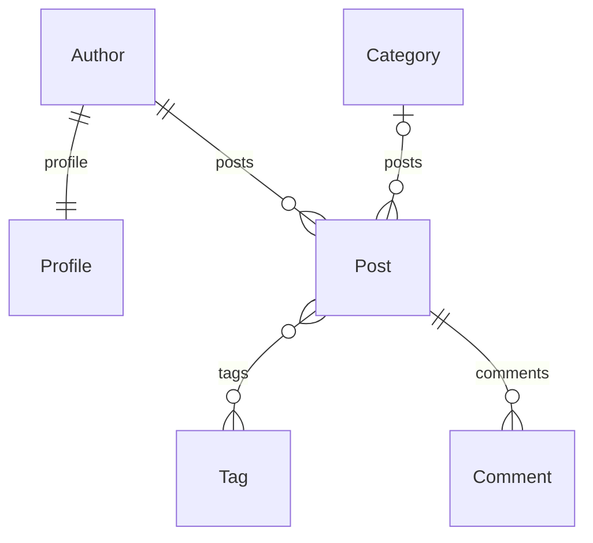

# Lab 07 ORM con IA

Alumna: Grecia Huanco Ticona.

Esta práctica continúa el repositorio de Lab 06. Se incorpora `src/blog` del
docente y su portada en `/lab07/`. La aplicación `news` mantiene sus modelos y
sus noticias: no se adapta el verificador cambiando las respuestas esperadas.

## Procedencia

Repositorio: https://github.com/Hellscythe25/dae-s07-orm-con-ia
Commit de origen: 8e7b74486fbd924dd0274c30d62914adc5a27419.
Los archivos iniciales de blog se conservan como material del docente.

## Puntos 1 a 3 Preparación y relaciones

Se utiliza el entorno virtual existente y los requisitos del proyecto. Django
6.1.1 cumple el requisito del docente `Django>=5.2,<7`.
Desde `src`, ejecutar `python manage.py migrate` y `python manage.py seed_blog`.
El comando seed_blog reemplaza únicamente los datos de blog.
Los resultados reales se guardan en `resultados/`.

Relaciones: cada autor tiene un perfil; un autor tiene varios artículos;
una categoría tiene varios artículos y puede faltar en un artículo;
un artículo tiene varias etiquetas y una etiqueta aparece en varios artículos;
un artículo tiene varios comentarios.

El diagrama digital sirve de referencia para el dibujo a mano solicitado.
La captura del dibujo a mano y las capturas de Visual Studio Code se incorporarán
como evidencias reales, sin sustituirlas por imágenes generadas.

## Formato de evidencia

Nombre, título, descripción breve, captura del código en Visual Studio Code,
captura del resultado, explicación y casos de prueba. Incluir la estructura
del proyecto. Las capturas todavía no incluidas deben marcarse como pendientes.
